# ✈️ Flight Booking System (SkyWings)

A microservices-based flight booking platform built with **Spring Boot**, **Spring Cloud** and **Angular**. Passengers can search flights, pick seats, pay, receive an invoice and e-mail, check in online and track their flight live. Admins manage flights, fleet, airports and support.

> **Status:** 🚧 Work in progress. The source code will be uploaded once the project is ready.

---

## 📸 Screenshots

Captured from the running application (Angular frontend talking to the live Spring Boot microservices through the API Gateway).

### Landing Page
Hero banner, quick flight search bar and navigation to flights, live radar, bookings and support.

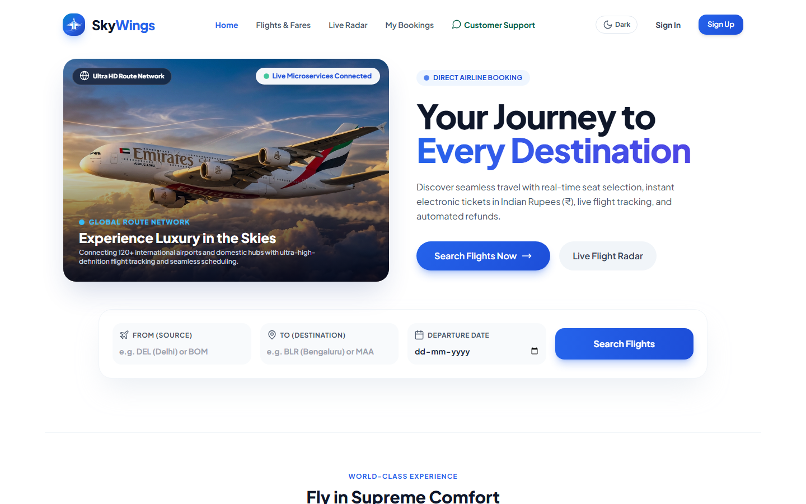

### Sign In
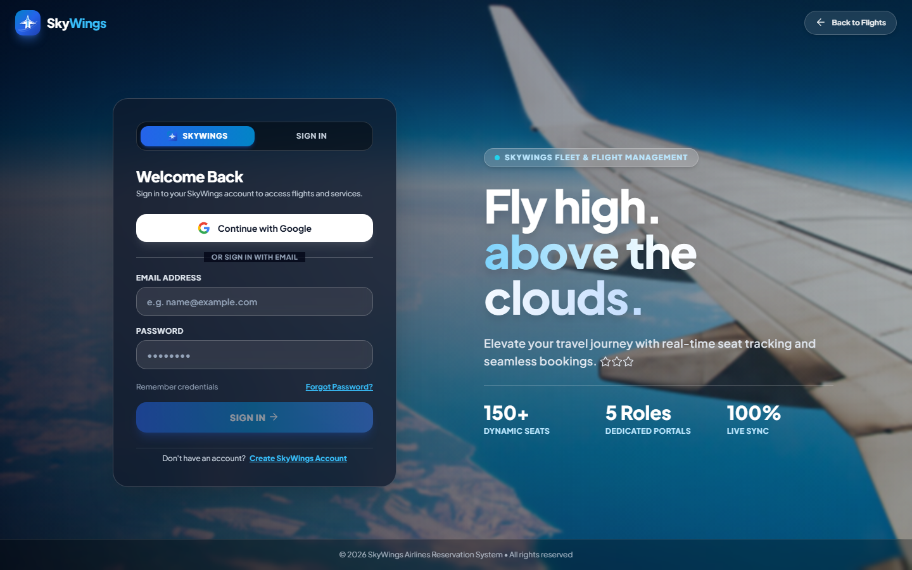

### Flight Search
Search by route and date, with fares, airline filters, cabin class, price slider, in-flight meal info and seat availability, all loaded live from the search, flight and fare services.

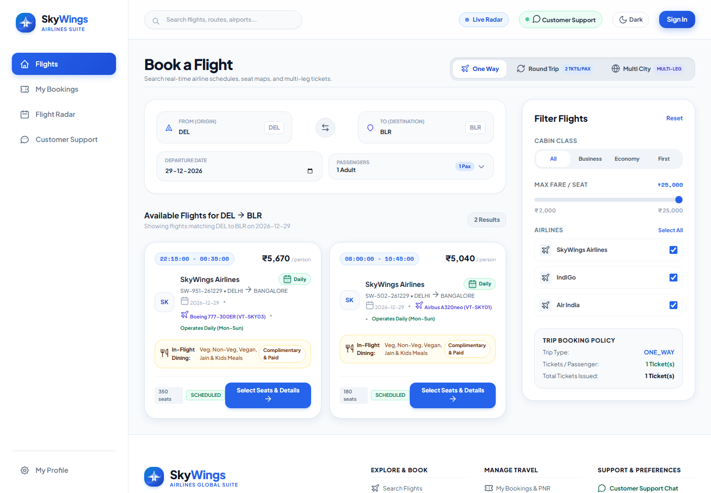

### Seat Selection
Aircraft cabin map with Business, Premium Economy and Economy cabins, exit rows, a per-passenger seat allocation panel, live price total and temporary seat holds.

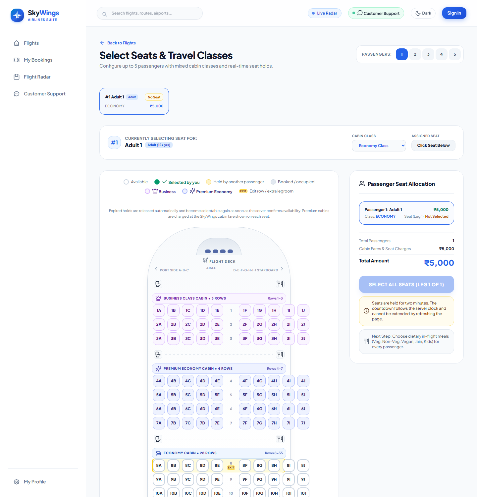

### Live Flight Radar
Real-time tracking showing altitude, ground speed, heading, gate and estimated arrival, refreshed every few seconds from the flight-tracking service.

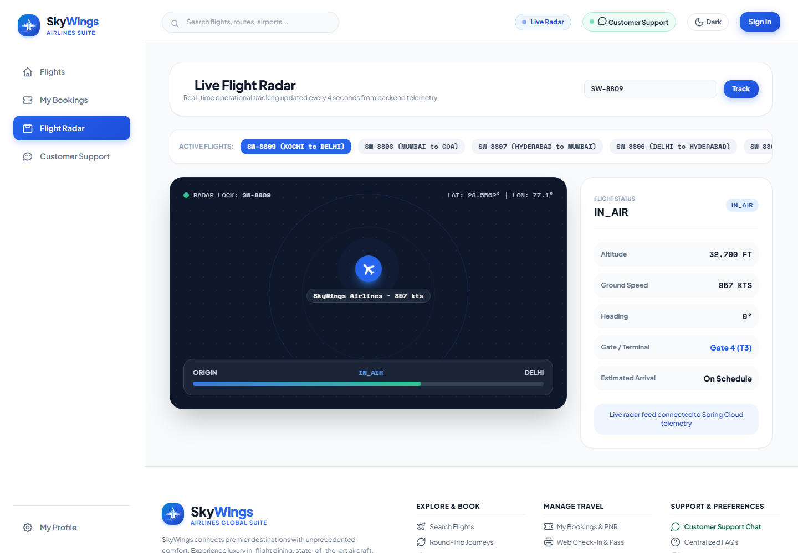

### My Bookings and E-Tickets
Passengers see every booking (PNR), flight, route, fare and seat, with options to view boarding passes, reschedule, or cancel with an instant refund.

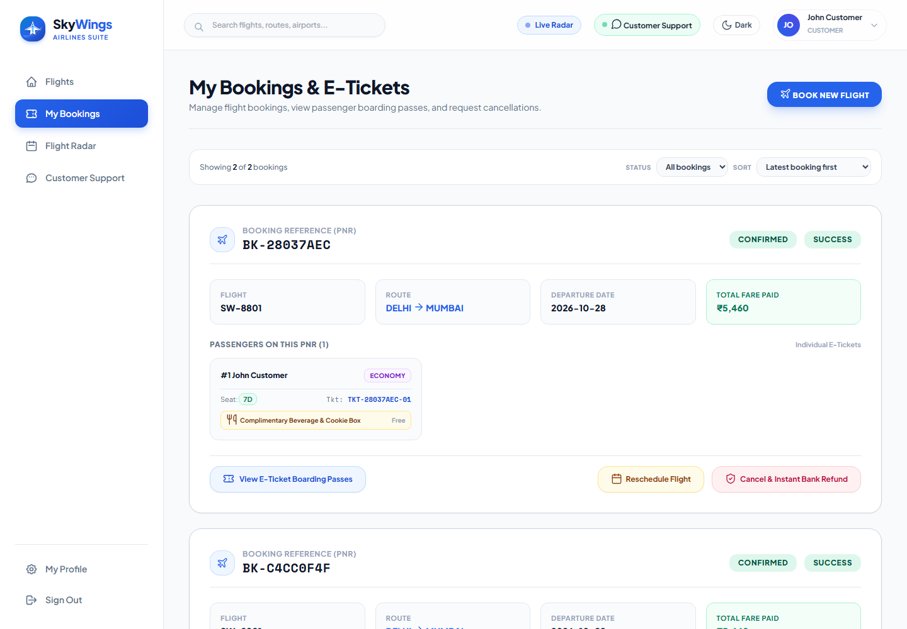

### Boarding Pass
Confirmed and paid bookings get an electronic boarding pass with ticket number, seat, gate, boarding time, in-flight meal and barcode. The pass is only issued after the booking service verifies the booking and payment.

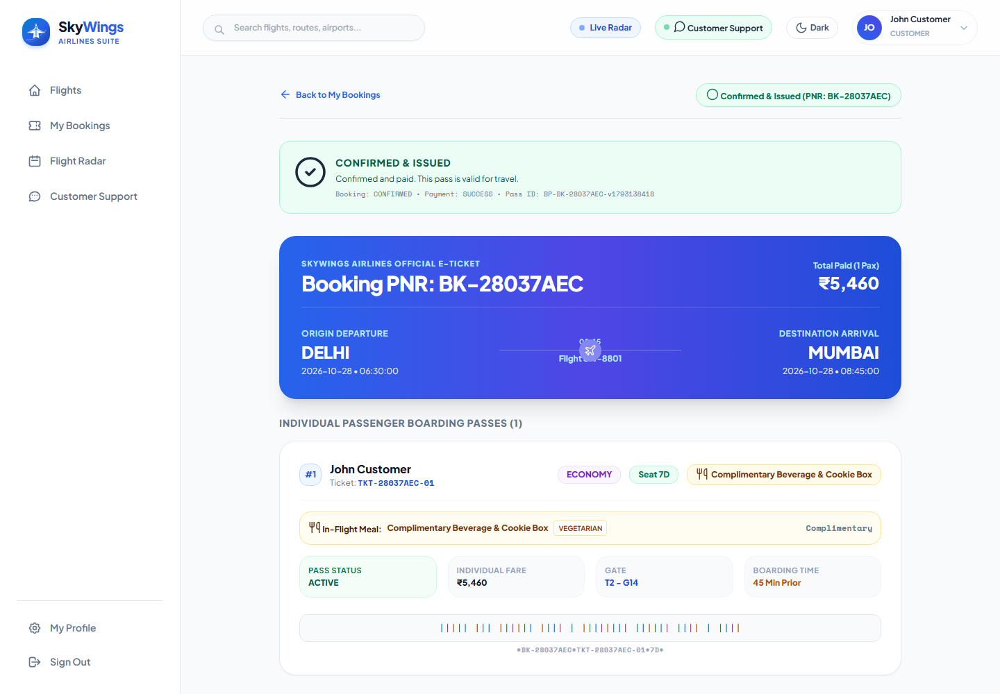

### Customer Support
Help desk with a support assistant, suggested topics and searchable FAQs.

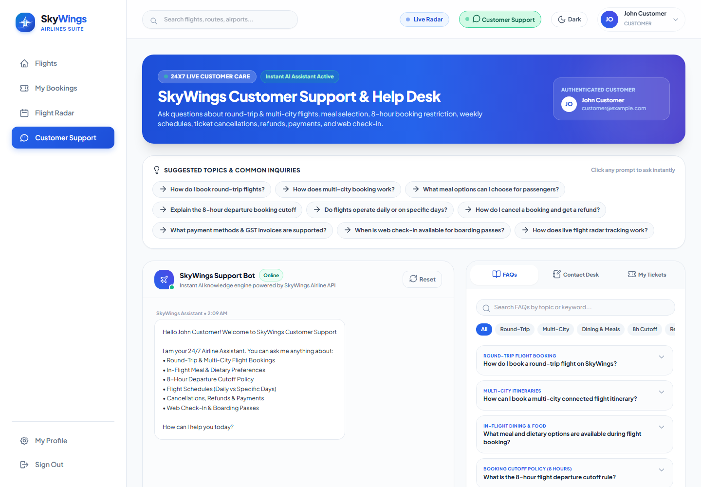

### Admin Dashboard
Operations view for administrators: KPI cards (flights, customers, bookings, revenue, pending payments), passenger bookings table, flight fleet and registered users. Passenger details in this screenshot are masked.

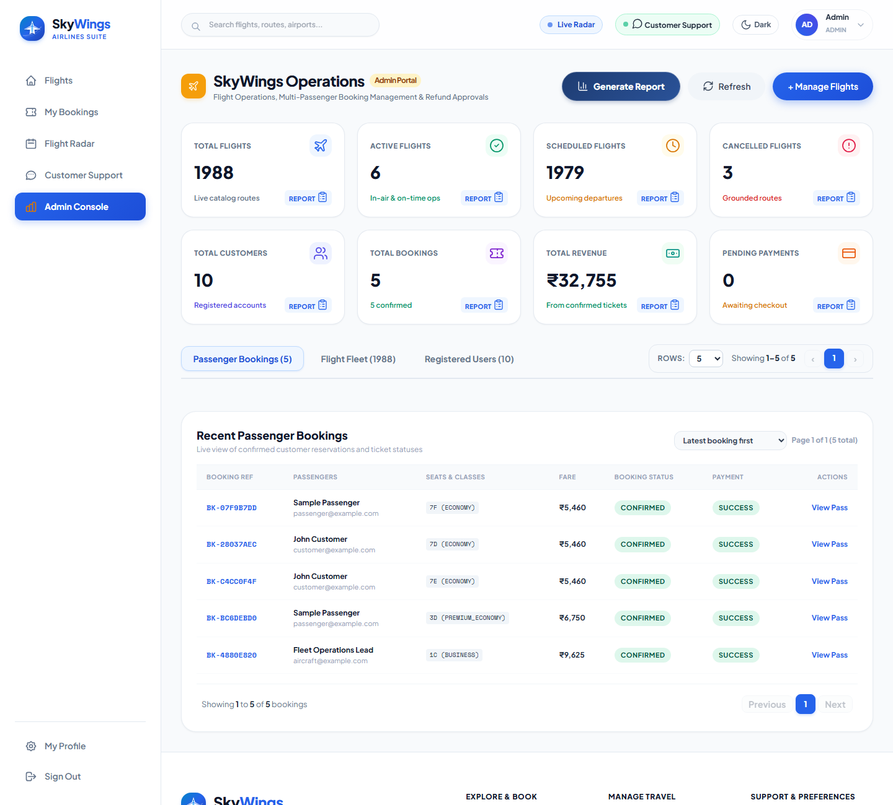

### Fleet and Flight Management Console
Airline operations can add and edit flights, manage aircraft, in-flight meals, weekly schedules and the cabin seat configuration.

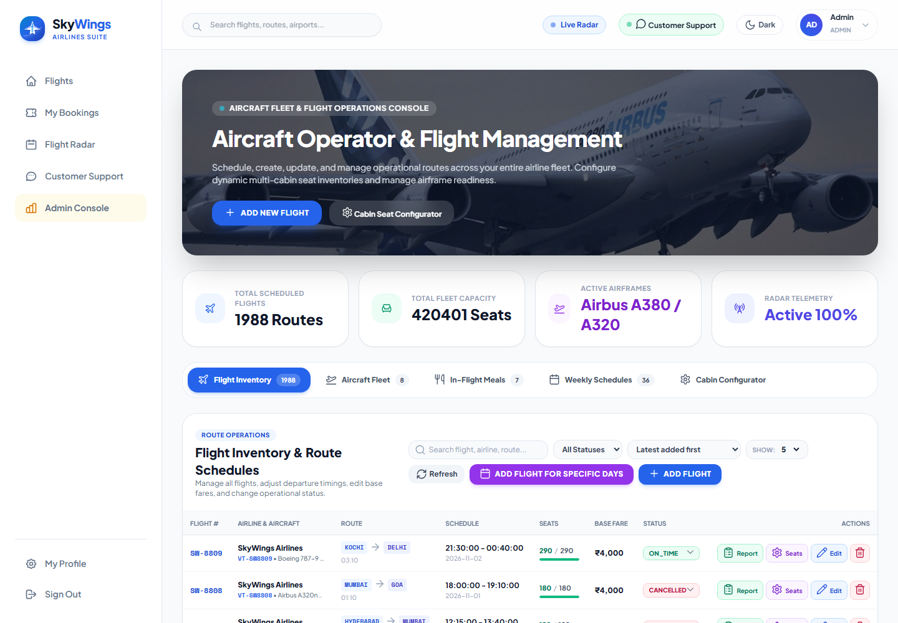

---

## 📑 Table of Contents

0. [Screenshots](#-screenshots)
1. [System Architecture](#1-system-architecture)
2. [Services and Ports](#2-services-and-ports)
3. [End-to-End Booking Workflow](#3-end-to-end-booking-workflow)
4. [Booking Sequence (Who Calls Whom)](#4-booking-sequence-who-calls-whom)
5. [Booking State Lifecycle](#5-booking-state-lifecycle)
6. [Event-Driven Messaging (RabbitMQ)](#6-event-driven-messaging-rabbitmq)
7. [Online Check-In Workflow](#7-online-check-in-workflow)
8. [Live Flight Tracking Workflow](#8-live-flight-tracking-workflow)
9. [Frontend Page Map](#9-frontend-page-map)
10. [Startup Order](#10-startup-order)
11. [Tech Stack](#11-tech-stack)

---

## 1. System Architecture

The Angular frontend talks only to the **API Gateway**. The gateway finds services through **Eureka** and forwards requests. All services read their settings from the **Config Server**. Services talk to each other in two ways: direct **Feign** calls when an answer is needed now, and **RabbitMQ** events when a reaction can happen later.

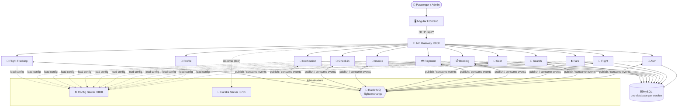

---

## 2. Services and Ports

| Service | Port | Responsibility |
|---------|------|----------------|
| `config-server` | 8888 | Central configuration for all services |
| `eureka-server` | 8761 | Service registry and discovery |
| `api-gateway` | 8080 | Single entry point, routes `/api/**` to services |
| `auth-service` | 8081 | Register, login (JWT and Google sign-in), password reset |
| `flight-service` | 8082 | Flights, schedules, aircraft, meals (admin managed) |
| `search-service` | 8083 | Fast flight search with fares |
| `booking-service` | 8084 | Creates and manages bookings, cancel, reschedule, refund |
| `fare-service` | 8085 | Prices per flight and class |
| `seat-service` | 8086 | Seat map, hold, book and release seats |
| `payment-service` | 8087 | Payments and refunds |
| `invoice-service` | 8088 | Generates invoices after payment |
| `notification-service` | 8089 | E-mail notifications |
| `checkin-service` | 8090 | Online check-in and boarding pass |
| `profile-service` | 8091 | Passenger profile and saved details |
| `flight-tracking-service` | 8092 | Live location, delay, gate and status updates |

---

## 3. End-to-End Booking Workflow

This is the main journey a passenger follows, from sign-up to boarding.

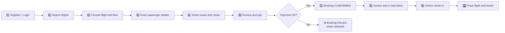

| Step | What the user does | What happens behind the scenes |
|------|-------------------|--------------------------------|
| 1 | Registers or logs in (e-mail or Google) | `auth-service` issues a JWT and publishes `auth.user.registered`, so the welcome e-mail goes out |
| 2 | Searches by route and date | `search-service` reads flights from `flight-service` and prices from `fare-service` |
| 3 | Picks a flight and class | `booking-service` checks the flight and fare through Feign |
| 4 | Enters passenger details | Details can be filled in from `profile-service` |
| 5 | Selects seats and meals | `seat-service` holds the seats temporarily (`seat.held`) |
| 6 | Pays | `payment-service` processes the payment and publishes `payment.success` or `payment.failed` |
| 7 | Sees the confirmation | `booking-service` marks the booking confirmed (`booking.confirmed`) and `seat-service` marks the seats as booked |
| 8 | Receives ticket and invoice | `invoice-service` creates the invoice (`invoice.generated`), `notification-service` sends the e-mail |
| 9 | Checks in online | `checkin-service` verifies the booking and seat, then publishes `checkin.completed` |
| 10 | Follows the flight | `flight-tracking-service` pushes live updates and delay or gate alerts |

---

## 4. Booking Sequence (Who Calls Whom)

Solid arrows are direct (Feign) calls. Dashed arrows are RabbitMQ events.

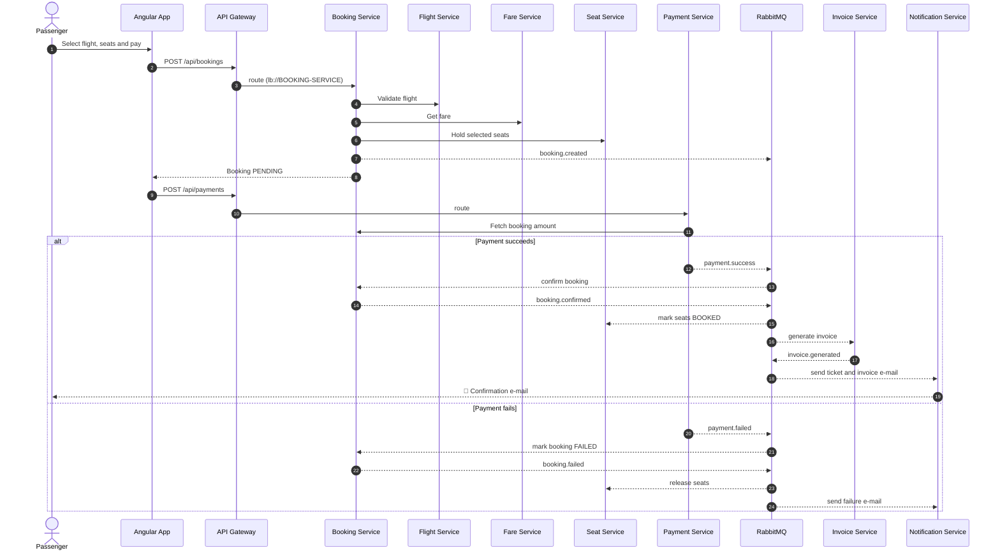

---

## 5. Booking State Lifecycle

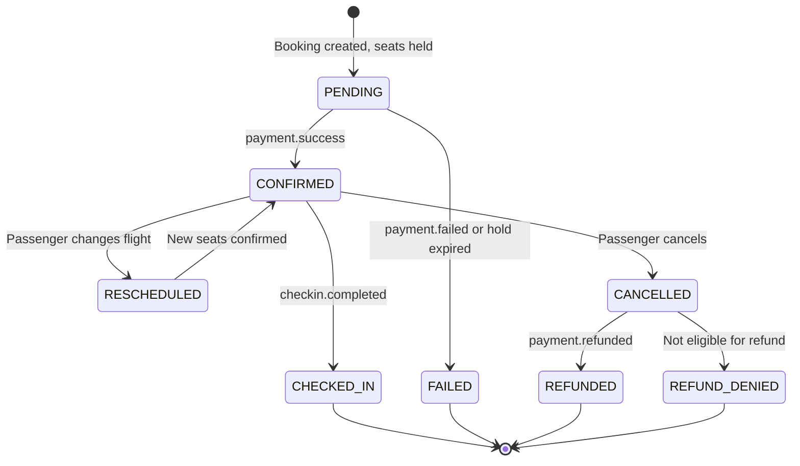

> The exact state names are illustrative and match the booking events the service publishes (`booking.created`, `confirmed`, `cancelled`, `rescheduled`, `refund.denied`, `failed`).

---

## 6. Event-Driven Messaging (RabbitMQ)

All services publish to one topic exchange, `flight.exchange`. Each interested service has its own durable queue, so a slow or offline consumer never blocks the publisher.

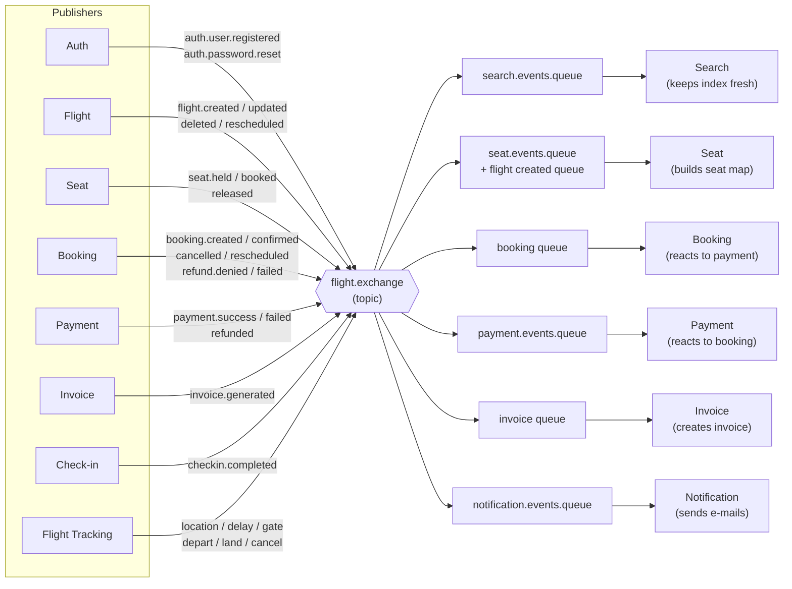

---

## 7. Online Check-In Workflow

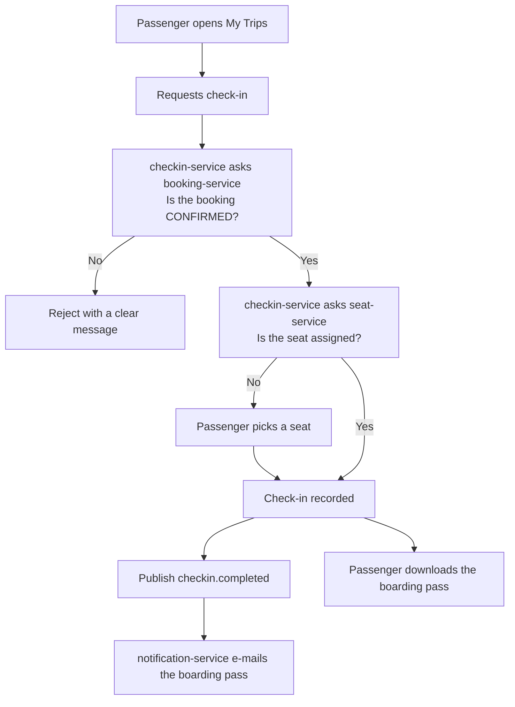

---

## 8. Live Flight Tracking Workflow

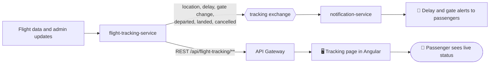

---

## 9. Frontend Page Map

The Angular app is split into `core` (guards, interceptors, models, services), `shared`, and one folder per feature.

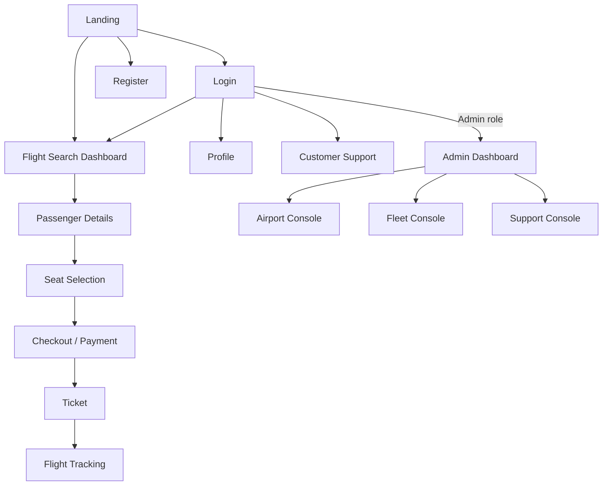

---

## 10. Startup Order

Services depend on each other, so start them in this order:

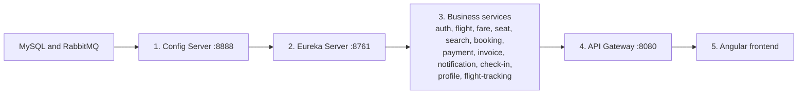

1. Run the SQL scripts in the `sql/` folder to create the databases.
2. Copy your secrets into a local `.env` file (database, RabbitMQ, mail, Google client). This file is **git-ignored** and never committed.
3. Start the services in the order above, then open the Eureka dashboard at `http://localhost:8761` to confirm they registered.
4. Use the Postman collections in `postman/` to test every endpoint through the gateway at `http://localhost:8080`.

---

## 11. Tech Stack

| Layer | Technology |
|-------|-----------|
| Frontend | Angular, TypeScript |
| Backend | Java, Spring Boot, Spring Security, Spring Data JPA |
| Microservices | Spring Cloud Gateway, Eureka, Config Server, OpenFeign |
| Messaging | RabbitMQ (topic exchange) |
| Database | MySQL (one schema per service) |
| API docs and testing | Swagger UI (springdoc), Postman |
| Build | Maven |

---

## 👤 Author

[ashadlo225-stack](https://github.com/ashadlo225-stack)
